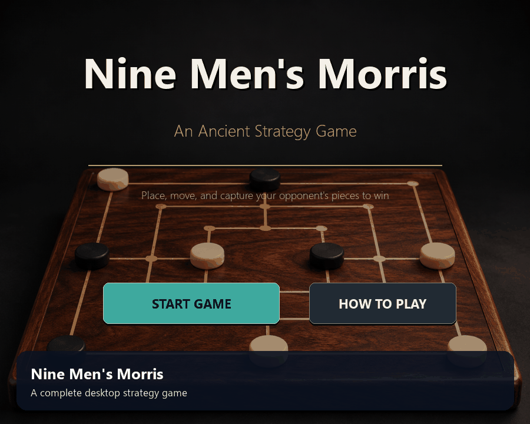
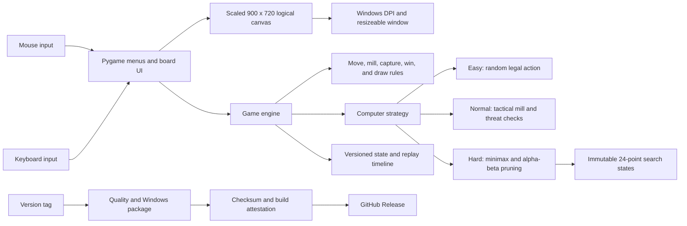
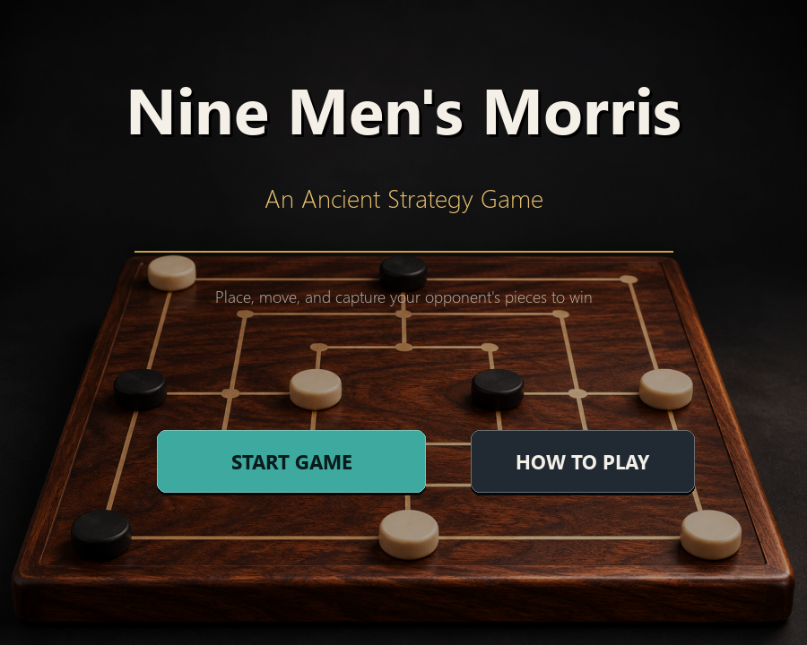
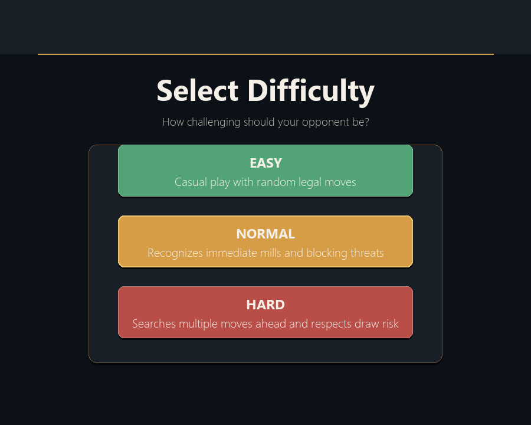
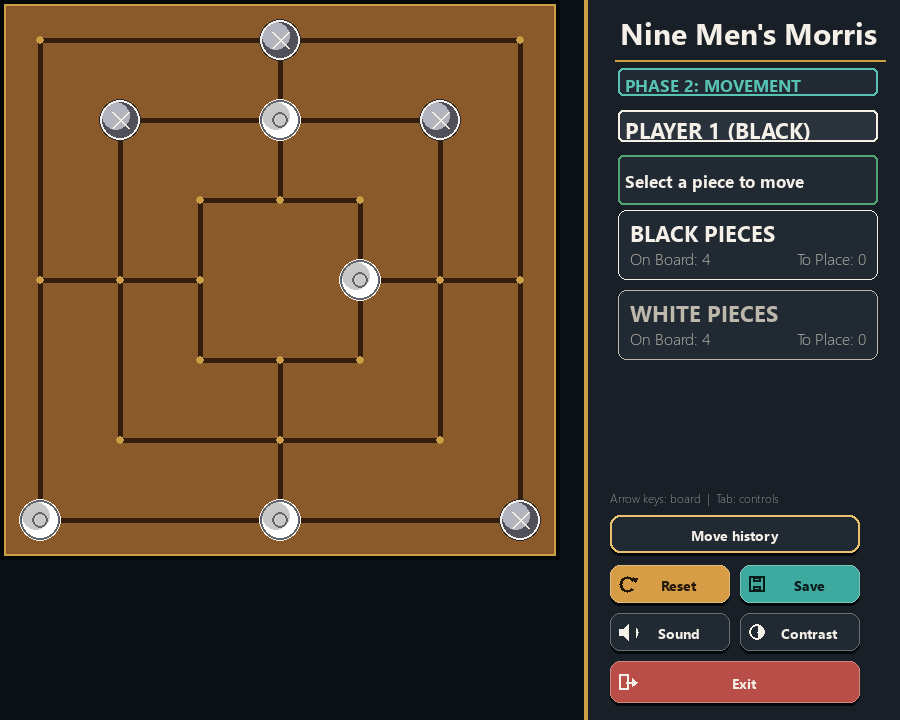
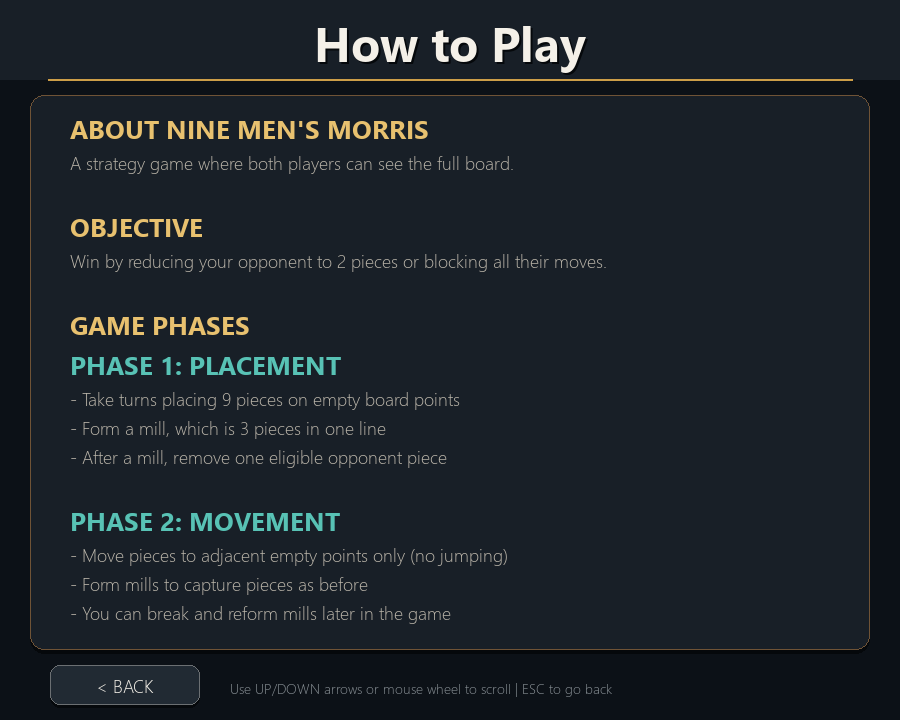
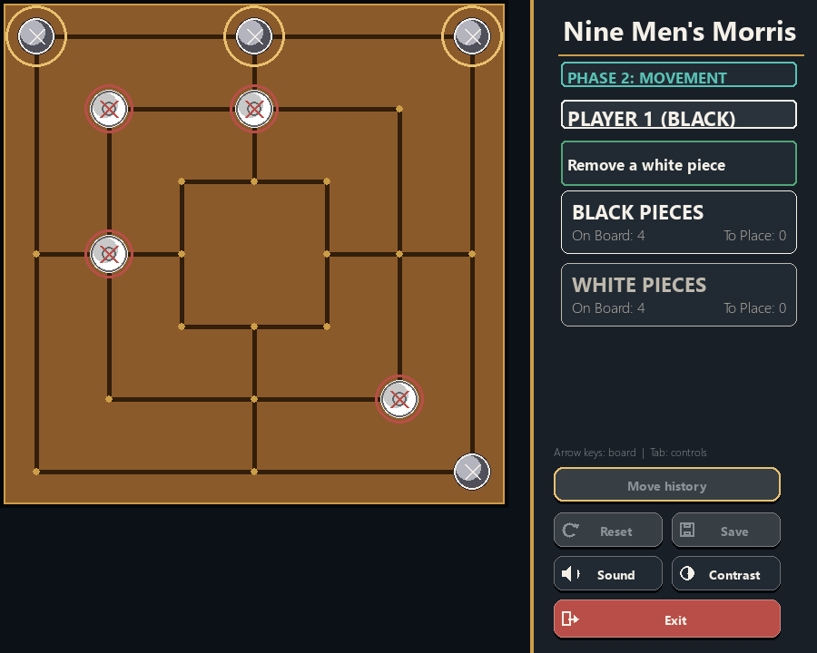
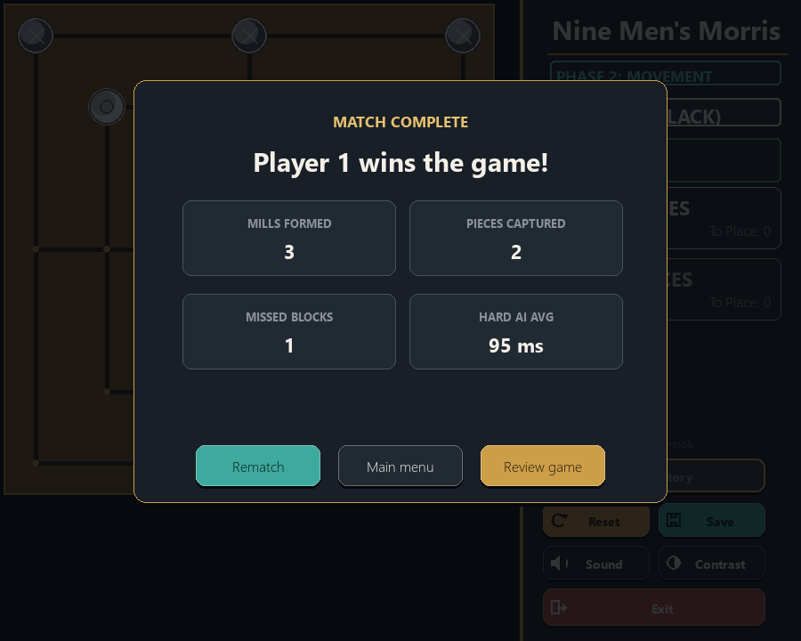
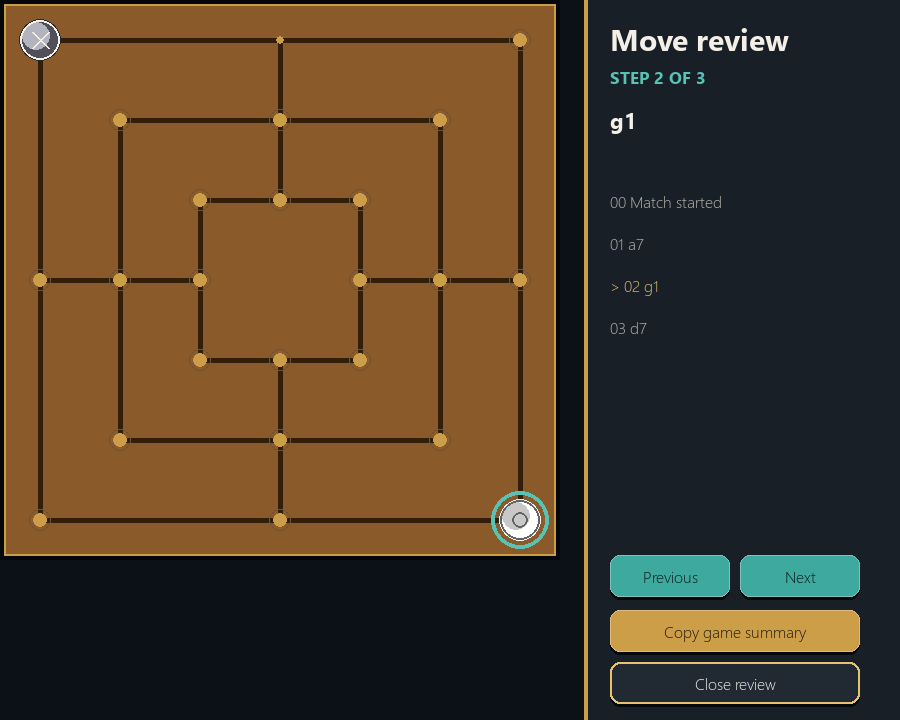
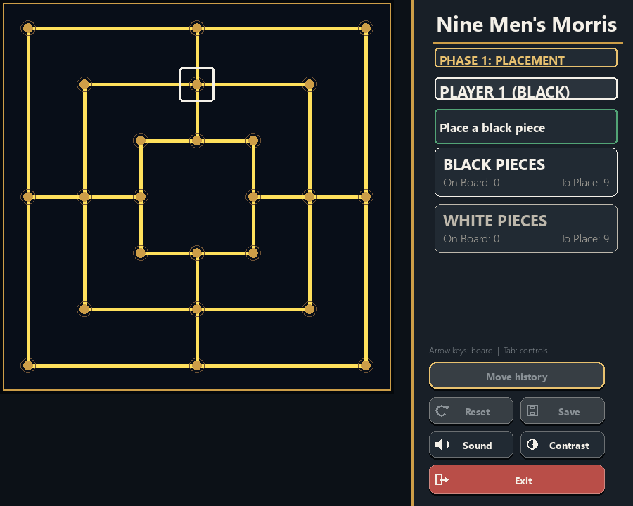

# Nine Men's Morris

[](https://www.python.org/downloads/)
[](https://github.com/pygame-community/pygame-ce)
[](https://github.com/Sarthak2661/nine-mens-morris/actions/workflows/tests.yml)
[](https://github.com/Sarthak2661/nine-mens-morris/releases/latest)
[](LICENSE)

[**Download the Windows game**](https://github.com/Sarthak2661/nine-mens-morris/releases/latest/download/nine-mens-morris-windows-x64.exe)
| [Verify SHA-256](https://github.com/Sarthak2661/nine-mens-morris/releases/latest/download/SHA256SUMS.txt)
| [Watch the product walkthrough](resources/nine-mens-morris-demo.mp4)



This is a Python/Pygame version of **Nine Men's Morris**, built as a playable desktop game with versioned save/resume, visual match review, post-game analysis, and three distinct computer difficulty levels.

## About Nine Men's Morris

Nine Men's Morris is a strategy board game where players place and move pieces to form mills, which are three pieces in a line. When a player forms a mill, they can capture one opponent piece. The game ends when a player is reduced to two pieces or has no legal moves left.

## Game Features

- Three game phases: placement, movement, and flying
- Two game modes: human vs human and human vs computer
- Three distinct computer difficulty levels with random, tactical, and search-based play
- Versioned JSON saves with exact match resume and corrupt-file validation
- Visual move review with previous/next navigation and changed-piece highlights
- Smooth Pygame board rendering and move feedback
- A shared dark visual system across menus, instructions, and the in-game status display
- Context-aware turn guidance, legal destination cues, removable-piece highlights,
  and mill feedback
- Optional generated sound effects, keyboard focus, protected reset/exit actions,
  and an end-game summary with move review
- Post-game mills, captures, missed-block, and Hard AI response-time statistics
- Full keyboard gameplay, visible focus, high-contrast rendering, and piece shape markers

## Architecture



The UI delegates every state transition to the game engine. AI search operates
on immutable board tuples, so exploring future positions cannot mutate the live
match. Packaging bundles the Python runtime, Pygame, source, and visual assets
into one portable executable.

## Interface

| Start screen | Difficulty selection |
|---|---|
|  |  |

| Hard AI tactical response | Built-in rules |
|---|---|
|  |  |

| Capture guidance | Match summary |
|---|---|
|  |  |

| Visual replay |
|---|
|  |

| High-contrast gameplay | Display verification |
|---|---|
|  |  |

The interface uses a shared charcoal, wood, brass, and teal palette with common
typography, spacing, panels, and interactive button states. The original v1.0.0
screen captures are retained in [`resources/baseline-v1.0.0`](resources/baseline-v1.0.0)
for visual regression comparison.

## Quick Start

### Prerequisites

- Python 3.14 or higher
- pip

### Installation

1. Clone the repository.

   ```bash
   git clone https://github.com/Sarthak2661/nine-mens-morris.git
   cd nine-mens-morris
   ```

2. Create and activate a virtual environment.

   ```bash
   python -m venv .venv
   ```

   Windows:

   ```bash
   .venv\Scripts\activate
   ```

   macOS/Linux:

   ```bash
   source .venv/bin/activate
   ```

3. Install dependencies.

   ```bash
   pip install -r requirements.txt
   ```

   Contributors can install the separate quality and packaging toolchain with:

   ```bash
   pip install -r requirements-dev.txt
   ```

4. Run the game.

   ```bash
   python main.py
   ```

## How to Play

### Controls

- Click an empty board point to place a piece during placement.
- Click one of your pieces, then click a valid destination to move during movement.
- Form a mill to remove one eligible opponent piece.
- Use the reset, save, move-history, sound, and exit controls from the game sidebar.
  Save writes a validated, versioned JSON snapshot to
  `saves/nine-mens-morris-save.json`; **Resume Match** restores it from the home screen.
- During move review, use **Previous** and **Next** or the left/right arrow keys.
  Changed pieces are highlighted directly on the board. The match summary can
  also be copied to the clipboard.
- Use **Tab** to move keyboard focus between controls and **Enter** or **Space**
  to activate the focused control. **Escape** closes a review or confirmation.
- Use the arrow keys to move keyboard focus across all 24 board points and
  **Enter** or **Space** to place, select, move, or capture.
- Toggle high-contrast mode with the sidebar control or **F2**. Black pieces use
  an X marker and white pieces use an inner ring, so ownership never depends on
  black/white or red/green color differences alone.
- Toggle generated sound feedback from the sidebar. The mute setting remains in
  effect when the current match is reset.
- Reset and exit require confirmation. A completed match shows the result,
  action and capture counts, rematch, main-menu, and move-review controls.

### Phase 1: Placement

Each player takes turns placing nine pieces on empty board points. Forming a mill immediately allows a capture.

### Phase 2: Movement

After all pieces are placed, players move pieces along connected board lines. Continue forming mills to capture opponent pieces.

### Phase 3: Flying

When a player has exactly three pieces left, that player can move to any empty point instead of only adjacent points.

## Win Conditions

- Reduce the opponent to two or fewer pieces.
- Block an opponent with three or more pieces from making any legal move.

## Draw Rules

- The same board position with the same player to move occurring three times
  ends the game in a draw.
- Fifty completed movement turns without a capture ends the game in a draw.
- Draw tracking starts after both players have placed all nine pieces. A win
  condition is evaluated before either draw condition.

## Computer Difficulty

- **Easy**: Chooses random legal placements, movements, and captures.
- **Normal**: Takes immediate mills and detects one-move movement threats before
  selecting a blocking move.
- **Hard**: Uses deterministic, depth-limited minimax with alpha-beta pruning,
  board evaluation, a transposition cache, and live repetition/no-capture context.

Hard evaluates material advantage, completed and potential mills, and mobility.
Moves and captures are ordered deterministically, making tactical benchmarks
and regressions reproducible. Search depth is intentionally capped at three to
keep interaction responsive during high-branching flying positions.

## Project Structure

```text
9-men-morris/
|-- main.py                 # Game entry point
|-- logic.py                # Game engine and rules implementation
|-- ai.py                   # Difficulty strategies and minimax search
|-- GUI.py                  # Game board rendering and in-game UI
|-- menu.py                 # Home, mode, difficulty, and instructions screens
|-- ui_theme.py             # Shared palette, typography, spacing, panels, and buttons
|-- sound_feedback.py       # Generated move, mill, capture, and completion tones
|-- game_persistence.py     # Versioned JSON save/load and validation boundary
|-- display.py              # DPI-aware resizeable logical window setup
|-- constants.py            # Game constants and configuration
|-- BL_tests.py             # Business logic unit tests
|-- GUI_tests.py            # GUI unit tests
|-- AI_tests.py             # Tactical and latency benchmark tests
|-- quality_tests.py        # Rule, invariant, and AI legality tests
|-- persistence_tests.py    # Save/resume, corruption, and replay tests
|-- requirements.txt        # Runtime dependencies
|-- requirements-dev.txt    # Test, lint, audit, and packaging tools
|-- requirements-media.txt  # Optional GIF and MP4 generation tools
|-- pyproject.toml          # Ruff, mypy, and coverage configuration
|-- scripts/build_game.py   # Cross-platform PyInstaller build script
|-- scripts/benchmark_ai.py # Reproducible AI quality and latency benchmark
|-- scripts/capture_release_media.py # Fresh screenshots, GIF, and MP4
|-- scripts/verify_display.py # Viewport, DPI, and high-contrast capture matrix
|-- scripts/write_checksum.py # SHA-256 release checksum
|-- release-notes/          # Versioned GitHub release notes
|-- ReadMe.md               # Project documentation
|-- .gitignore              # Git ignore rules
|-- .github/                # GitHub workflows and templates
`-- resources/              # Background and screenshot assets
```

## Testing

Run the full test suite:

```bash
python -m unittest discover -p "*tests.py" -v
```

The 79-test suite covers game rules, draw handling, complete phase transitions,
endgame behavior, GUI behavior, state invariants, capture limits, AI legality,
save/resume integrity, corrupt saves, visual replay, and tactical positions for
winning, blocking, capturing, flying, and draw-aware decisions. CI enforces
at least 90% branch coverage across the game and AI engines.

| Quality gate | Current result |
|---|---:|
| Automated tests | 79 passing |
| Game and AI branch coverage | 97% |
| AI legal-action rate | 100% on benchmark fixtures |
| Ruff formatting and linting | Pass |
| mypy type checking | Pass |
| Runtime dependency audit | No known vulnerabilities |
| Clean Windows package smoke test | Pass |

Compare legal-action rate, tactical success, mean move latency, and
95th-percentile latency across all three difficulties with:

```bash
python scripts/benchmark_ai.py
```

Reference result on Python 3.14.6 for the included winning, blocking,
capturing, and flying positions:

| Difficulty | Legal actions | Tactical success | Mean latency | P95 latency |
|---|---:|---:|---:|---:|
| Easy | 100% | 10.4% | 0.02 ms | 0.03 ms |
| Normal | 100% | 100% | 0.25 ms | 0.63 ms |
| Hard | 100% | 100% | 70.51 ms | 224.31 ms |

Timing varies by machine. The benchmark uses fixed seeds and deterministic
tactical fixtures so changes remain comparable.

Run all local quality gates with:

```bash
ruff check .
ruff format --check .
mypy
coverage run -m unittest discover -p "*tests.py" -v
coverage report
pip-audit -r requirements.txt
```

Build the Windows executable with:

```bash
python scripts/build_game.py
python scripts/write_checksum.py
```

The portable output is `dist/nine-mens-morris-windows-x64.exe`. Python is not
required on the computer that runs the packaged game.

GitHub Actions blocks changes that fail linting, formatting, type checking,
tests, coverage, dependency auditing, Windows packaging, or packaged-app
startup.

## Display Verification

The game uses a stable 900 x 720 logical canvas with resizeable, DPI-aware
presentation. Automated captures cover 800 x 640, 1366 x 768, and 1920 x 1080
in standard and high-contrast modes. Scale-factor checks cover 100%, 125%, and
150%. See the [display verification procedure](docs/display-verification.md).

## Release Process

Pushing a version tag such as `v1.1.0` starts `.github/workflows/release.yml`.
The workflow reruns every quality gate, builds and smoke-tests the Windows
executable, generates `SHA256SUMS.txt`, records GitHub build-provenance
attestations, and publishes both files to a GitHub Release.

```bash
git tag -a v1.1.0 -m "Nine Men's Morris v1.1.0"
git push origin v1.1.0
```

An installer and code signing are intentionally deferred until the portable
build has demonstrated stable usage.

## Rules Implemented

- Mills are horizontal or vertical only.
- Pieces slide along board lines during the movement phase.
- A player may remove pieces outside mills first; pieces inside mills can be removed only when all opponent pieces are in mills.
- Captured pieces are permanently removed.
- Flying is allowed when a player has exactly three pieces.
- The game ends when a player has two pieces or no legal moves.

## Technology Stack

- Python 3.14
- Pygame Community Edition 2.5.7
- Python unittest
- Ruff, mypy, coverage, and pip-audit
- PyInstaller

## Known Limitations

- Hard AI is depth-limited; it is intentionally responsive rather than perfect.
- The Windows executable is not code-signed and may trigger SmartScreen.
- The release is a portable executable, not an installer.
- Online multiplayer and controller input are not implemented.
- The smallest supported window is 800 x 640. Automated rendering checks target
  Windows scaling at 100%, 125%, and 150%; each tagged release still requires the
  documented manual DPI check on Windows.

## Future Enhancements

- Optional light theme and player-selectable appearance settings
- More elaborate movement, capture, and turn-change animations
- Player-selected piece colors
- Board theme customization
- Optional background music and selectable sound packs
- Online multiplayer support
- Named save slots and a searchable match archive
- Tournament mode

## License

This project is licensed under the MIT License. See [LICENSE](LICENSE) for details.

## Asset Provenance

- `resources/background.png` was generated specifically for this project with
  OpenAI's image generation tool and is distributed with this repository under
  the MIT License.
- The remaining PNG files in `resources/` are screenshots captured from the game.

## Acknowledgments

- Nine Men's Morris rules from traditional public game rules and historical references
- Pygame Community Edition for the graphics library
- UMKC Advanced Software Engineering course inspiration
