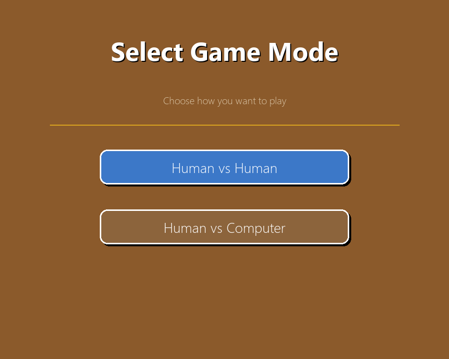

# Nine Men's Morris

[](https://www.python.org/downloads/)
[](https://github.com/pygame-community/pygame-ce)
[](LICENSE)

This is a Python/Pygame version of **Nine Men's Morris**, built as a playable desktop game with a menu, rule screen, save support, and three distinct computer difficulty levels.

## About Nine Men's Morris

Nine Men's Morris is a strategy board game where players place and move pieces to form mills, which are three pieces in a line. When a player forms a mill, they can capture one opponent piece. The game ends when a player is reduced to two pieces or has no legal moves left.

## Screenshots





## Game Features

- Three game phases: placement, movement, and flying
- Two game modes: human vs human and human vs computer
- Three distinct computer difficulty levels with random, tactical, and search-based play
- Save move history for review and debugging (game restoration is not implemented yet)
- Smooth Pygame board rendering and move feedback
- Menu screens, instructions, and in-game status display

## Quick Start

### Prerequisites

- Python 3.14 or higher
- pip

### Installation

1. Clone the repository.

   ```bash
   git clone https://github.com/Sarthak2661/nine-mens-morris.git
   cd nine-mens-morris
   ```

2. Create and activate a virtual environment.

   ```bash
   python -m venv .venv
   ```

   Windows:

   ```bash
   .venv\Scripts\activate
   ```

   macOS/Linux:

   ```bash
   source .venv/bin/activate
   ```

3. Install dependencies.

   ```bash
   pip install -r requirements.txt
   ```

   Contributors can install the separate quality and packaging toolchain with:

   ```bash
   pip install -r requirements-dev.txt
   ```

4. Run the game.

   ```bash
   python main.py
   ```

## How to Play

### Controls

- Click an empty board point to place a piece during placement.
- Click one of your pieces, then click a valid destination to move during movement.
- Form a mill to remove one eligible opponent piece.
- Use the reset, save, and exit controls from the game sidebar. Save writes the
  current move history to `game_state.txt`; it does not restore a match yet.

### Phase 1: Placement

Each player takes turns placing nine pieces on empty board points. Forming a mill immediately allows a capture.

### Phase 2: Movement

After all pieces are placed, players move pieces along connected board lines. Continue forming mills to capture opponent pieces.

### Phase 3: Flying

When a player has exactly three pieces left, that player can move to any empty point instead of only adjacent points.

## Win Conditions

- Reduce the opponent to two or fewer pieces.
- Block an opponent with three or more pieces from making any legal move.

## Draw Rules

- The same board position with the same player to move occurring three times
  ends the game in a draw.
- Fifty completed movement turns without a capture ends the game in a draw.
- Draw tracking starts after both players have placed all nine pieces. A win
  condition is evaluated before either draw condition.

## Computer Difficulty

- **Easy**: Chooses random legal placements, movements, and captures.
- **Normal**: Takes immediate mills and detects one-move movement threats before
  selecting a blocking move.
- **Hard**: Uses deterministic, depth-limited minimax with alpha-beta pruning,
  board evaluation, and a transposition cache.

## Project Structure

```text
9-men-morris/
|-- main.py                 # Game entry point
|-- logic.py                # Game engine and rules implementation
|-- ai.py                   # Difficulty strategies and minimax search
|-- GUI.py                  # Game board rendering and in-game UI
|-- menu.py                 # Home, mode, difficulty, and instructions screens
|-- constants.py            # Game constants and configuration
|-- BL_tests.py             # Business logic unit tests
|-- GUI_tests.py            # GUI unit tests
|-- AI_tests.py             # Tactical and latency benchmark tests
|-- quality_tests.py        # Rule, invariant, and AI legality tests
|-- requirements.txt        # Runtime dependencies
|-- requirements-dev.txt    # Test, lint, audit, and packaging tools
|-- pyproject.toml          # Ruff, mypy, and coverage configuration
|-- scripts/build_game.py   # Cross-platform PyInstaller build script
|-- scripts/benchmark_ai.py # Reproducible AI quality and latency benchmark
|-- ReadMe.md               # Project documentation
|-- .gitignore              # Git ignore rules
|-- .github/                # GitHub workflows and templates
`-- resources/              # Background and screenshot assets
```

## Testing

Run the full test suite:

```bash
python -m unittest discover -p "*tests.py" -v
```

The test suite covers game rules, draw handling, complete phase transitions,
endgame behavior, GUI behavior, state invariants, capture limits, AI legality,
and tactical positions for winning, blocking, capturing, and flying. CI enforces
at least 90% branch coverage across the game and AI engines.

Compare legal-action rate, tactical success, mean move latency, and
95th-percentile latency across all three difficulties with:

```bash
python scripts/benchmark_ai.py
```

Reference result on Python 3.14.6 for the included winning, blocking,
capturing, and flying positions:

| Difficulty | Legal actions | Tactical success | Mean latency | P95 latency |
|---|---:|---:|---:|---:|
| Easy | 100% | 10.4% | 0.02 ms | 0.02 ms |
| Normal | 100% | 100% | 0.25 ms | 0.63 ms |
| Hard | 100% | 100% | 85.19 ms | 281.31 ms |

Timing varies by machine. The benchmark uses fixed seeds and deterministic
tactical fixtures so changes remain comparable.

Run all local quality gates with:

```bash
ruff check .
ruff format --check .
mypy
coverage run -m unittest discover -p "*tests.py" -v
coverage report
pip-audit -r requirements.txt
```

Build the Windows executable with:

```bash
python scripts/build_game.py
```

GitHub Actions blocks changes that fail linting, formatting, type checking,
tests, coverage, dependency auditing, Windows packaging, or packaged-app
startup.

## Rules Implemented

- Mills are horizontal or vertical only.
- Pieces slide along board lines during the movement phase.
- A player may remove pieces outside mills first; pieces inside mills can be removed only when all opponent pieces are in mills.
- Captured pieces are permanently removed.
- Flying is allowed when a player has exactly three pieces.
- The game ends when a player has two pieces or no legal moves.

## Technology Stack

- Python 3.14
- Pygame Community Edition 2.5.7
- Python unittest
- Ruff, mypy, coverage, and pip-audit
- PyInstaller

## Future Enhancements

- UI cleanup and a more consistent visual style
- Better movement, capture, and turn-change animations
- Player-selected piece colors
- Board theme customization
- Sound effects and background music
- Online multiplayer support
- Game replays and statistics tracking
- Tournament mode

## License

This project is licensed under the MIT License. See [LICENSE](LICENSE) for details.

## Asset Provenance

- `resources/background.png` was generated specifically for this project with
  OpenAI's image generation tool and is distributed with this repository under
  the MIT License.
- The remaining PNG files in `resources/` are screenshots captured from the game.

## Acknowledgments

- Nine Men's Morris rules from traditional public game rules and historical references
- Pygame Community Edition for the graphics library
- UMKC Advanced Software Engineering course inspiration
