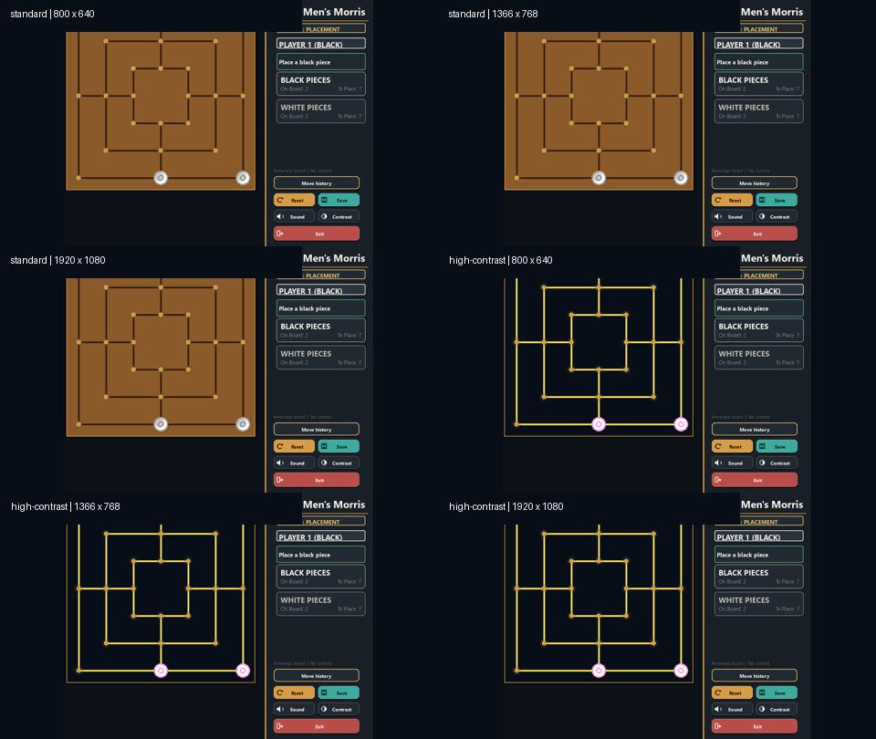

# Display Verification

The game renders to a stable 900 x 720 logical canvas through Pygame's scaled,
resizeable window mode. Mouse coordinates remain in logical-canvas space while
Windows and SDL scale the final window for the active DPI setting.

## Automated Matrix

Run:

```bash
python scripts/verify_display.py
```

The script verifies standard and high-contrast gameplay at:

- 800 x 640 (smallest supported window)
- 1366 x 768
- 1920 x 1080
- 100%, 125%, and 150% logical scaling



The generated `display-report.json` records the current Windows DPI and every
rendered viewport. Automated captures complement, but do not replace, the manual
release check below.

## Manual Windows Release Check

Before publishing a release, repeat this checklist at 100%, 125%, and 150%
Windows display scaling:

1. Open the home, instructions, mode, and difficulty screens.
2. Start a match and reach placement, movement, capture, and review states.
3. Navigate the board with arrow keys and activate a point with Enter.
4. Navigate controls with Tab and activate each with Enter or Space.
5. Toggle high contrast with its button and F2.
6. Confirm that no text clips and every control remains reachable.
7. Confirm that black pieces use an X and white pieces use an inner ring.

The automated run on 2026-11-16 detected 96 DPI (100% scaling) on Windows and
passed all three supported viewport sizes. The 125% and 150% states are covered
by deterministic render captures and remain part of the manual release gate.
